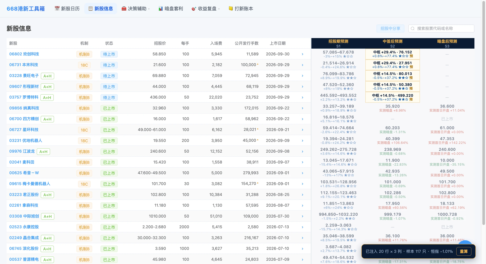
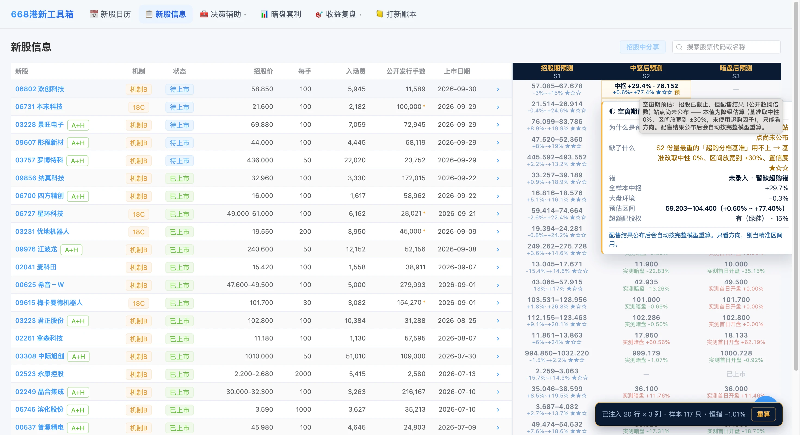
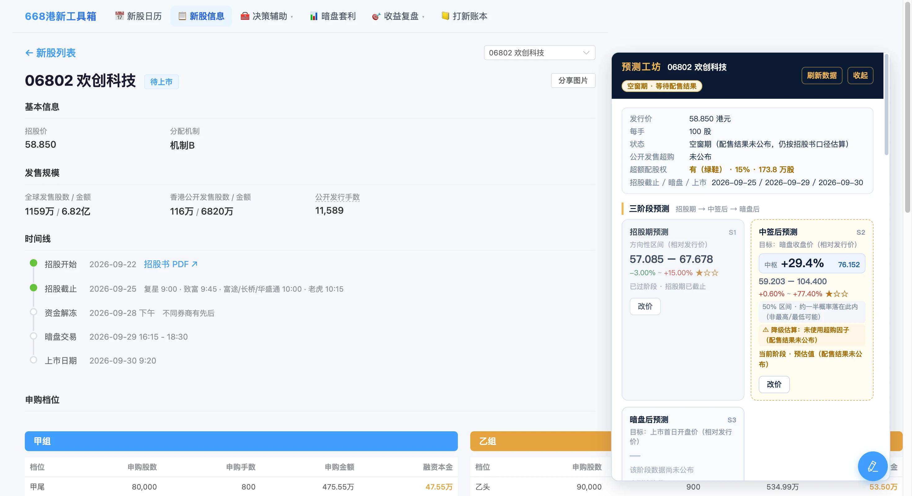
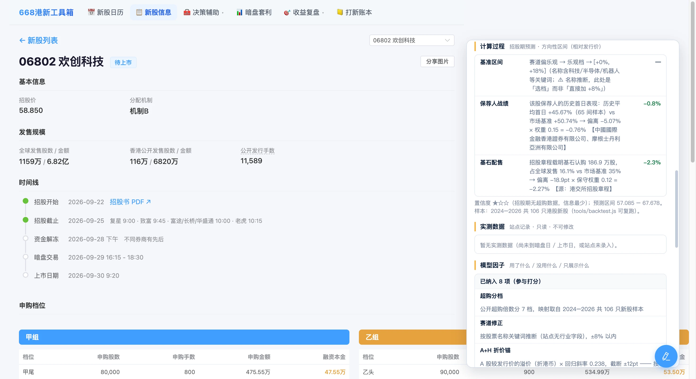

# 港股打新预测 · i668 增强（浏览器插件）

> **一句话**：拿过去 129 只港股新股的真实表现当「老师」，反推一只新股上市后（暗盘 / 首日）大概能涨多少，并**老实标出这个预测有多不靠谱**——区间窄 = 有把握，区间宽 = 这只在历史样本里本来就没规律。

在 [i668 港新工具箱](https://www.i668.vip) 的两处做增强，**不改动站点任何原有结构**。

## 安装（离线加载，免费）

**固定下载地址 —— 永远指向最新代码包，发给别人只需这一个链接（收藏即可）：**

<https://github.com/SongYouAI/i668-ipo-predict/releases/latest/download/i668-ipo-predict.zip>

> `releases/latest/download/` 是 GitHub 的永久别名：我发新版本时它会自动指向新包，
> 使用者不用通知、不用换链接，每次点同一个地址都是最新。下载的是**干净分发包**，
> 不含 `tools/`、`screenshots/`、`.git` 等开发文件。

1. 打开 Chrome / Edge 的扩展管理页（`chrome://extensions` 或 `edge://extensions`），开启「开发者模式」。
2. 点「加载已解压的扩展程序」，选择本仓库目录（或解压出来的 `i668-ipo-predict/` 目录，必须是含 `manifest.json` 的那一层）。
3. 访问 https://www.i668.vip/stocks ，右下角出现浮条即生效。

> 改过代码须在扩展管理页点「重新加载」；**改过 `manifest.json` 必须重新加载**（浏览器只在启动时读一次清单）。

**给非技术用户安装**：见 [install/安装说明.md](install/安装说明.md)。
目录里还带两个一键脚本（`install/` 下），会自己找安装包、解压到固定目录、把路径放进剪贴板，
然后告诉使用者剩下的 4 步怎么点 —— Chrome 规定那 4 步必须人手动。

### 数据会自动更新，不用重装

因子库（129 只）与模型参数（超购七档 / S3 偏移 / A+H 线性 / 基石权重 / 汇率）**不在代码里**，
而是运行时从 `dist/latest.json`（68KB）拉取，缓存到本机。改数据、重标定参数后，
使用者**不用重新安装**，下次打开页面自动用上（每 6 小时检查一次）。

想立刻拿到最新：点插件图标 →「更新数据」。若当前正开着 i668 页面，面板会多出一个
「刷新页面即刻生效」，点一下就完成 —— 这是**一键**，不用重装、不用碰 `chrome://extensions`。

只有改 `content/*.js` 算法时才需要重新分发代码。**代码更新没有静默通道**（不在应用商店），
但插件会自动发现并提醒：点「更新数据」时若远端 `appVersion` 高于本地，面板直接显示新版本号
和下载地址 —— 使用者不会在不知情的情况下一直用旧版。详见 [TECHNICAL.md](TECHNICAL.md) 的数据架构章节。

## 怎么用

### 列表页 `/stocks`
- 表格**最右追加三列**预测：招股期（S1）/ 中签后（S2）/ 暗盘后（S3），随阶段与大盘实时更新，**一屏全见**，站点原有列序 / 列宽 / 行高不动。
- 列状态：未到阶段显「—」；已过阶段灰显保留；当前阶段琥珀金描边高亮；数据未公布显「待公布」。
- 悬浮任一预测格：弹出摘要卡（锚 / 关键因子 / 区间 / 置信度 / 模型未纳入项）；点任一格进详情页。

### 详情页 `/stocks/<代码>`：「预测工坊」
页面顶部插入工坊卡片，五个区块：

| 区块 | 内容 |
|---|---|
| 三阶段预测 | 三张卡：模型区间 + 涨跌幅 + 置信度星级 + 状态（当前 / 已过 / 未到 / 已出实测）；每张卡可「改价」 |
| 计算过程 | 当前阶段的**逐项增量表**，每步写明理由，末尾给出「修正后基准」与「展开区间」 |
| 实测数据 | 暗盘收盘 / 首日收盘（**只读**，标注站点口径） |
| 复盘 | 你设过且已有实测时，给出「你的设定 vs 实际」与高估/低估点数 |
| 模型因子 | 三段：已纳入 8 项 + 只展示 3 项 + 未纳入 2 项及原因 |

**改价**：点任一阶段卡「改价」→ 填区间（下沿/上沿，可填 `25.5` 或 `+50%`）→ 可加备注 → 保存，即刻变为「✎ 人工设定」，并提供「恢复模型值」。

### 界面截图

列表页：一屏看尽三阶段预测


鼠标移到「招股期预测」列头，弹出该因子的口径说明（数据来源 / 标定依据 / 命中率）。


详情页「预测工坊」：三阶段预测 + 计算过程


「计算过程」逐层摊开 + 因子模型清单（已纳入 / 只展示 / 拿不到）。


### Popup 设置（点扩展图标）
- A→H 汇率（CNY→HKD，默认 1.09）
- 启用实时大盘行情（恒指 + A 股比价，默认开）
- **模拟日期**：填某日可预览该日三列行为与置灰效果，留空 = 今天

## 预测原理（简要）

模型用 **2024–2026 共 129 只真实港股新股**当训练样本（其中 115 只「超购倍数 + 暗盘」齐全，用于分档标定），按**条件分位法**给每只新股一个带置信区间的预测：

- **中枢** = 该条件集（超购档位 / A+H 溢价 / 全样本兜底）的**中位数**；
- **区间** = 该条件集的 **[P25, P75]** 不对称分位（真实的 50% 中央区间，标称覆盖率）；
- **三阶段**：S1（招股期，无超购给方向性宽区间）、S2（中签后，核心预测）、S3（暗盘后，以暗盘为锚复盘）。阶段按**时间相位**判定，自动随打开日期刷新。
- **因子三态**：8 个已纳入打分 / 3 个只展示不入权重（绿鞋、发售结构、散户中签率）/ 2 个免费源拿不到（国配明细、未上市开盘价）。每个权重都做过实测消融，没有拍脑袋。

实测精度（`node tools/backtest.js` 可复跑，n=115）：**S2 区间名义 50%，实际命中 45.2%**，点估计误差中位 23.0pt；2026-07 后（n=31）命中 41.9%、误差 8.3pt。**区间越宽 = 这只真的没把握**，如实告知，比假装精确有用。

> 空窗期（招股已截止、配售结果未公布）会退到 A+H 溢价线性模型：n=39、命中 **53.8%**、误差 7.1pt、区间仅 21pt 宽。
> 但这是**样本内**成绩（同一批 39 只既用来标定又用来回测），真实样本外会低一些 —— 别拿 53.8% 当预期。

> 完整的数据源表、逐步手算、因子全表、消融实验与复现流程，见 [TECHNICAL.md 技术白皮书](TECHNICAL.md)。

## 数据来源与隐私

- **纯前端、免费、离线加载**；运行时只向 i668 接口与腾讯行情取数（均为公开免费源），**不向任何第三方上传你的数据**。
- **免费因子库**（保荐人战绩 / 首日开盘价 / 基石配售 / 绿鞋）由随插件加载的本地文件 `data/extras.js` 提供——构建期从 etnet 公开页与港交所招股章程抓取烤入，**插件运行时不请求这些站点**。
- **改价数据只存在本机** `chrome.storage.local`，不联网。

## 注意事项（踩过的坑，简要）

- **预测是统计推断，不是荐股、不保收益**——它是概率区间，不是承诺。
- **必须配合 i668 港新工具箱使用**：本插件是「增强」它的页面，不是独立站点。
- **免费源仍有两类拿不到**：国配明细（认购人结构，付费数据商内容）与未上市股的开盘价（尚未发生）。模型按中性处理，**用「改价」把你掌握的信息补进去**。
- **站点前端改版可能导致匹配失效**：列表侧浮条会如实报「未匹配到新股表格」，工坊侧显示「未能取得该股数据」，渲染异常逐格降级，不静默、不拖垮整表。

## 已知局限（说清楚，免得误用）

| 局限 | 具体到什么程度 | 界面怎么处理 |
|---|---|---|
| **高超购档样本极旧** | ≥500 倍档在 2026-07 后只有 0–1 只样本（6000 倍以上**一只都没有**），那几档参数基本是上半年高热环境的值，而市场 7 月已反转 | 工坊里逐档标注「样本 n=7（近期 1 / 历史 6，λ=0.11）」+「该档可能偏高，只当方向参考」 |
| **A+H 溢价关系已失效** | 2026-07 后溢价与暗盘的相关系数从 +0.43 掉到 +0.02，斜率被压到 0.086 | 计算过程里明写「该关系基本失效，只作很弱的方向参考」 |
| **A+H 降级成绩是样本内** | 53.8% 是同一批 39 只标定又回测的结果 | 本文档标注，不写进界面当卖点 |
| **暗盘只有收盘口径** | 站点不提供暗盘开盘价，所有「实测暗盘」都是收盘价 | 卡片上写「实测暗盘收盘」 |
| **破发概率是历史频率** | 按该档历史破发比例统计，**没做概率校准**（未做 Platt/isotonic），不是严格意义的概率 | 标注「该档历史上有 X% 收在发行价之下」 |
| **国配明细拿不到** | 认购人结构（谁是长线基金）是付费数据商内容，免费源一律不披露 | 因子表的「缺失」清单里明列 |
| **S1 只有方向** | 招股期没有超购数据，只能给宽区间，非 A+H 时完全靠名称推断赛道 | 置信封顶 ★☆☆，标注「名称推断」 |

## 想深入了解？看技术白皮书

### 👉 [TECHNICAL.md —— 完全技术白皮书](TECHNICAL.md)

写给**完全不懂代码的小白**和**第一次接触本项目的 Agent**，目标只有一个：**看完就能复刻**。

| 章节 | 你能拿到什么 |
|---|---|
| [第 4 章](TECHNICAL.md#4) | 数据源全表：5 个数据源（含 API 签名、腾讯 GBK 坑） |
| [第 5 章](TECHNICAL.md#5) | 阶段系统：S1/S2/S3、数据阶段 vs 时间相位、空窗期 |
| [第 6 章](TECHNICAL.md#6) | 逐步手算：S1/S2/S3 完整公式 |
| [第 7 章](TECHNICAL.md#7) | 因子全表：8 纳入 / 3 展示 / 2 缺失 |
| [第 8 章](TECHNICAL.md#8) | 为什么 6 个因子被砍掉（n=106 消融实测） |
| [第 10 章](TECHNICAL.md#10) | 复现全流程 + 10 个必踩的坑 |

> 白皮书里所有数字都能用 `tools/verify-calc.js` 复验（当前基线：**129 只 / 368 阶段 / 0 错误**），
> 模型命中率可用 `node tools/backtest.js` 复跑（该脚本已改为直接加载 `content/core.js`，不再自带参数）。
>
> S2 区间命中率，新旧参数在同一批 115 只上的对比：
>
> | 口径 | 旧参数 | 新参数 |
> |---|---|---|
> | 全期（2026-01 起，n=115） | 46.1% | **45.2%** |
> | 2026-07 后（n=31，当前环境） | 38.7% | **41.9%** |
>
> **别把这次改动说成"大幅提升"**：命中率只挪了 3pt 左右，n=31 时这点差异在噪声范围内
> （标准误约 ±9pt），统计上不显著。全期还略降——那是**故意**放弃拟合上半年高温行情的代价。
>
> 这次真正确定的收益不在命中率，而在三件可验证的事：
> ① **低超购档中枢下移**（−2.9% → −4.9%），当前市场主力就在这一档；
> ② **S3 的「涨超 50% 取 0.7 倍」被证伪**（实测首日/暗盘比值 1.01、相关系数 0.99），
>    点估计误差从 8.7pt 降到 4.6pt；
> ③ **新增破发概率**：15 倍以下档 83% 会破发，1000–3000 倍档 30 只里 0 破发。

## 目录结构

```
i668-ipo-predict/
├── manifest.json             # MV3 清单
├── background.js             # service worker：远程数据/PDF 下载（脱离页面 CORS）
├── data/extras.js            # 内置因子库（打包时快照；运行时会被远程版覆盖）
├── data/ahclose.js           # 内置 A+H 基准价（同上）
├── dist/latest.json          # 远程参数库（build-remote.mjs 生成，扩展本身不读它）
├── content/                  # core.js / list.js / detail.js / boot.js / styles.css
├── popup/                    # 设置页（数据版本 / 检查更新 / 反馈）
├── install/                  # 非技术用户：Mac/Windows 一键脚本 + 安装说明
├── tools/                    # backtest.js / verify-calc.js / build-remote.mjs
│                             # fetch-etnet.py / fetch-ah-close.py / fetch-prospectus.py / make-icons.py
├── screenshots/              # README 用界面截图
└── README.md
```

## 版本历史

| 版本 | 要点 |
|---|---|
| **0.6.3** | 修 0.6.2 的**假警报**：远端 `appVersion` 若被塞进杂字（如 `9.9`），旧实现是把非数字剔掉 → 变成 `9.9` → 误报「有新版本」。改为**整串校验** `/^[0-9]+(\.[0-9]+)*$/`，不合规一律当无效。这个 bug 是写成「chrome 桩 + 4 组用例」的自动化测试跑出来的，不是靠看代码发现的 |
| **0.6.2** | **分发链路收口**：popup 的「检查数据更新」改为「更新数据」，更新后若正开着 i668 页面则直接给「刷新页面即刻生效」一键按钮（`chrome.tabs.reload`），把原本「更新完再自己回去刷新」的三步压成一步。补掉一个静默漏洞：**远端 `appVersion` 高于本地时显示代码新版本与下载地址**（此前数据在更新、代码却一直是旧版，使用者无从得知）。下载地址统一为 `releases/latest/download/` 永久别名 —— 发新版本不用再改链接或重新通知 |
| **0.6.1** | 数据与算法分离的收尾：加 `background.js`，用 **GitHub 最新 commit sha 拼 jsDelivr 地址**，绕开分支引用 12 小时缓存 —— 实测推送后 3.7 秒即可拿到新版（直接请求 `@main` 仍返回旧版）。remote 请求统一走 background，顺带摆脱页面 CORS 约束 |
| **0.6.0** | **数据与算法分离**：因子库与模型参数外置为 `dist/latest.json`（68KB），运行时拉取并缓存，改数据不用重装扩展。`core.js` 新增 `validRemote()` 严格校验 + `applyRemote()` 就地覆盖；`EX`/`AHC` 改 `let` 支持整体替换；`CS_BASE/K/CAP` 收进对象 `CS`。踩坑：`JSON.stringify(Infinity) === "null"`，末档必须在应用时还原。popup 新增数据版本展示、检查更新、一键复制诊断信息反馈；新增 `tools/build-remote.mjs`（7 项自检）与 `install/`（Mac/Windows 一键脚本 + 小白说明） |
| **0.5.5** | 绿鞋兜底改**按需 Range 下载**：不再把整份 20MB+ 章程拉完再解析，只取前 80 页所需的块。同一份 23.7MB / 476 页章程三轮交替实测：全量 14.1s / 22.6MB → Range 6.1s / 6.6MB（**2.3×、省 71% 流量**，绿鞋结论一致）。DNR 规则补 `access-control-expose-headers`（pdf.js 靠 Content-Range 推总大小）；Range 失败自动退回全量。修正详情页「解析中」文案里未实测的耗时承诺 |
| **0.5.4** | 超购档参数表加 `nh/nr`（历史/近期样本数），工坊逐档标注样本时效（λ 注释原误写 0，实为 0.11）；`tools/backtest.js` 改为加载 `ahclose.js`，首次量化**空窗期 A+H 降级路径**（n=39 / 命中 53.8% / 误差 7.1pt）；修掉详情页文案里漏出的 Markdown 星号；README 补「已知局限」并把过时的 48.2% 更正为实测 45.2% |
| **0.5.3** | **A+H 溢价改回「招股截止日 A 股收盘价」口径**（新增 `data/ahclose.js` 离线固化 + `tools/fetch-ah-close.py`）。旧实现用实时价，40 只 A+H 里 39 只漂移、中位 −40pt、最大 −120pt（02249 晶合集成 +102.8% → −17.8%），模型输入跑出标定分布；计算过程里现在会写明「A 股价取 X 日收盘 Y 元」 |
| **0.5.2** | A+H 溢价改为**线性标定**（斜率 0.086、残差 [P25,P75]），区间命中 12.8% → 51.3%，并删掉 `AH_BUCKETS` 三段档；`tools/fetch-etnet.py` 修好 etnet 改版导致的「首日開市升跌」失配（109 → 118 只）与 `--quick`/重建时误删 `pros` 的坑 |
| **0.5.1** | 不适用判定：延期（postponed）/ 搁置（shelved）/ 无公开发售（介绍上市）的股票不再生成三阶段预测，列表与详情统一标「已延期 / 已搁置 / 无公开发售」 |
| **0.5.0** | 市场反转后的模型重标定：S2 分层混合（7 月后覆盖 38.7%→41.9%、全期 46.1%→45.2%，n=31 不显著）+ 新增破发概率；S3 修掉「涨超 50% 取 0.7 倍」的错误假设（实测首日/暗盘 = 1.01，误差 8.7→4.5pt）；绿鞋解析打通港交所跨域 |
| **0.4.0** | 可解释模型 + 详情页「预测工坊」+ 手动改价 + 复盘 + 悬浮摘要卡 |
| 0.3.0 | 放开站点宽度锁实现一屏全见（先锁后放） |
| 0.2.3 | 实测优先（暗盘/首日实测不再给预测） |
| 0.2.2 | 插件图标；滚动条加粗常显 |
| 0.2.1 | 三列改追加到最右；行高 32→33px |
| 0.2.0 | el-table 适配；真实状态反馈 |
